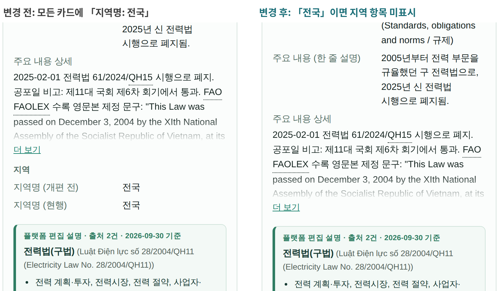
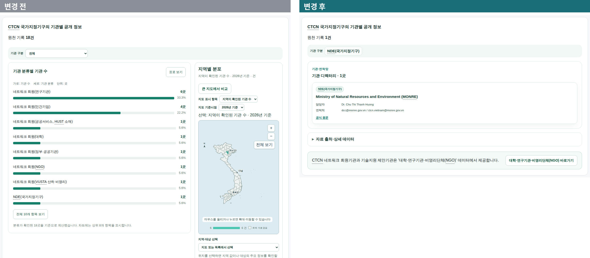
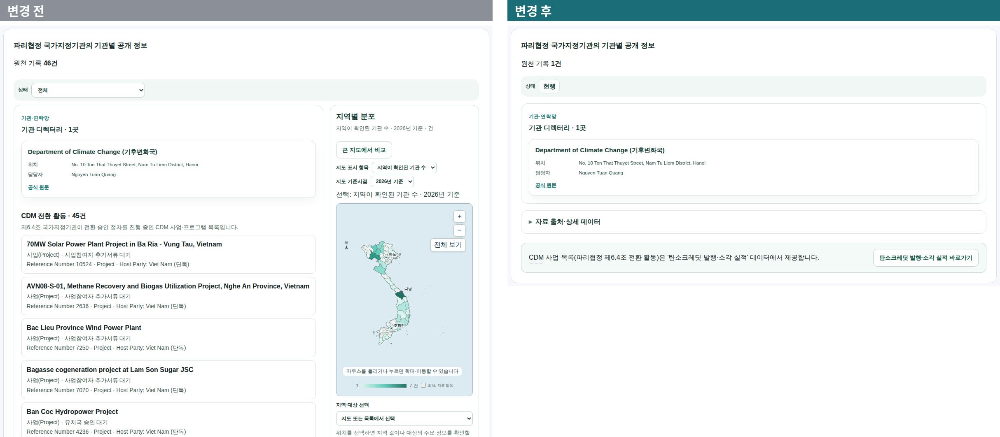
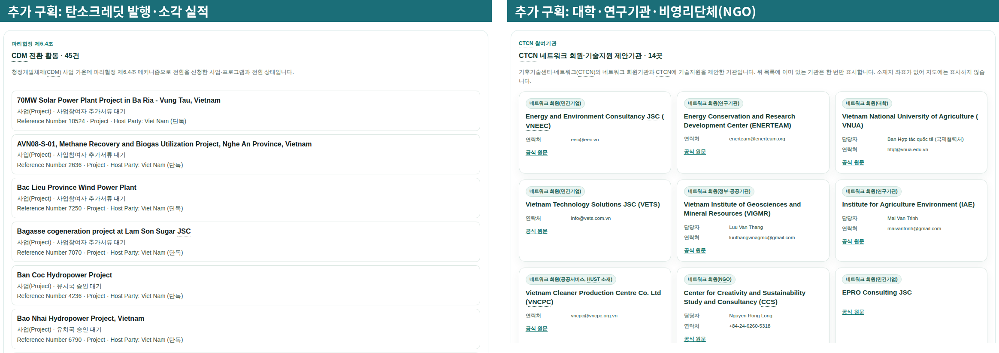
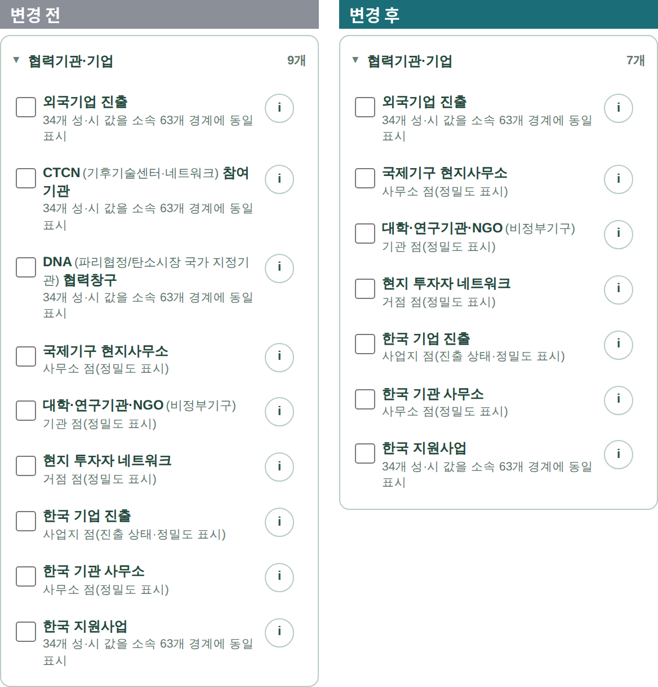

<!-- 플랜아이 전달 기준서 원문(붙임1 PDF의 원본, 2026-10-30 발송 예정). PDF는 scratchpad notice.html → Playwright로 생성 -->
# 지역 단위 데이터 표출 기준 변경

2026\. 10. 30. 국가녹색기술연구소 글로벌전략센터

## 1. 개요

- 목적: 데이터 수집 용역사(STADT)의 10개국 공간해상도 확인 결과를 반영하여 지역 단위 데이터의 화면 표출 기준을 정함
- 성격: 베트남 파일럿 화면 완성(2026. 10. 30.) 이후 반영할 변경 사항
- 반영 시기

| 구분 | 반영 시기 |
|---|---|
| 3-가. 법제도·치안 카드의 지역 항목 | 용역 기간 내 |
| 3-나. 기관 화면(E-001·E-002) | 11월 10일 최종발표 이후, 용역 기간 내 |
| 3-다. 지역 정보 유무에 따른 표출 | 데이터 수집 용역사 최종 납품 데이터 반영 시 |

- 연구소 플랫폼(nigtldcmap.vercel.app)에 3-가·3-나를 반영함. 변경 후 화면은 5장의 주소에서 확인

## 2. 공통 원칙

- 지역 지도와 지역 선택은 데이터에 지역 정보(1급 행정구역 코드, 또는 권역·관할 구역과 행정구역의 대응표)가 있을 때만 표시하고, 없으면 국가 단위로 표시함
- 국가별로 코드를 나누지 않고 데이터의 지역 정보 유무로 판단함(국가가 추가되어도 코드 수정 없음)
- 원자료가 권역·관할 구역 단위이면 그 값을 소속 행정구역 모두에 같은 값으로 표시하며, 행정구역별로 나누지 않음
- 원자료에 없는 경계·좌표는 만들지 않음

## 3. 변경 항목

### 가. 법제도·치안 카드의 지역 항목(C-009·C-010·C-011·C-019)

| 데이터 | 변경 전 | 변경 후 |
|---|---|---|
| C-009 기후 법제도 현황 C-010 기타 환경 관련 법제도 현황 C-019 탄소 시장 관련 법률·예산 | 모든 카드에 '지역명: 전국' 표시 | 지역명이 빈칸이거나 '전국'이면 지역 항목을 표시하지 않음 특정 지역에만 적용되는 법령(예: 꽝닌 (Quảng Ninh))은 지역 항목 표시 |
| C-011 치안·안전 정보 | 모든 카드에 '지역명: 전국' 표시 | 지역 항목을 표시하지 않음(지역 선택 없이 국가 단위로만 제공) |

- 판정: 지역명 값이 비어 있거나 전국을 뜻하는 값('전국', 'Nationwide' 등)이면 지역 항목을 표시하지 않음
- 그 밖의 데이터 카드는 현행 유지

### 나. 기관 화면(E-001·E-002)

| 데이터 | 변경 전 | 변경 후 |
|---|---|---|
| E-001 각국 기후기술 창구기관(NDE) | 기관 18곳(NDE·네트워크 회원·기술지원 제안기관) 목록 '기관 분류별 기관 수' 그래프 지역별 분포 지도 | 국가별 NDE 1곳의 기관 카드 그래프와 지역별 분포 지도 삭제 '대학·연구기관·비영리단체(NGO) 바로가기' 추가 |
| E-002 감축사업 승인기관(DNA) | DNA 1곳과 'CDM 전환 활동' 목록(베트남 45건) 지역별 분포 지도 | 국가별 DNA 1곳의 기관 카드 'CDM 전환 활동' 목록과 지역별 분포 지도 삭제 '탄소크레딧 발행·소각 실적 바로가기' 추가 |
| E-005 대학·연구기관·비영리단체(NGO) | 대학·연구기관·NGO 목록 | E-001에서 옮겨 온 'CTCN 네트워크 회원·기술지원 제안기관'을 함께 표시(이미 있는 기관은 한 번만 표시) |
| C-025 탄소크레딧 발행·소각 실적 | 탄소크레딧 사업 목록·지도 | E-002에서 옮겨 온 'CDM 전환 활동' 목록(사업명·유형·전환 상태) 추가 |
| 데이터 지도 | '협력기관·기업'에 CTCN 참여기관·DNA 협력창구 포함 | 두 항목 제외(베트남 9개 → 7개) |

- 데이터 수집 용역사 최종 납품 데이터에는 네트워크 회원·기술지원 제안기관이 E-005에, CDM 전환 활동이 C-025에 수록되므로 납품 데이터대로 표시하면 됨
- CDM 전환 활동 중 위치(좌표)가 있는 사업은 C-025 지도에 표시하되, C-025 사업 목록과 같은 사업은 한 번만 표시함(연구소 플랫폼 미반영)

### 다. 지역 정보 유무에 따른 표출

| 데이터 | 기본 표출 | 지역 표출 조건 |
|---|---|---|
| A-013 NDC·SDG 연계 목록 | 국가 단위 'NDC 부문×SDG' 연계표 | 조치에 행정구역 코드가 있으면 해당 지역을 지도에 표시(현재 베트남: 원문에 지역명이 적힌 조치, 24개 성·시) |
| A-022 정전빈도 | 국가 값 | 전력공사(배전회사) 관할 구역 값과 '관할 구역 ↔ 행정구역' 대응표가 있으면 소속 행정구역 모두에 같은 값 표시(현재 베트남) |
| B-012 재해·재난 이력(EM-DAT) | 행정구역 단위 | 피해 행정구역 코드로 지역 표시, 위경도가 있는 재해는 점으로 추가 표시 |
| B-021 지역 취약성(GVI) | 지역 선택 표시 | '권역 ↔ 행정구역' 대응표에 따라 소속 행정구역 모두에 같은 값 표시('대응 불가' 권역은 지도에서 제외하고 목록으로 제공) |
| B-025 유역 면적 | 유역 대표점과 안내 문구(현행) | 유역 코드와 유역 경계 파일이 납품되면 유역 경계(면)로 표시 |
| C-008 국제 이니셔티브 | 국가 단위 목록 | 참여 주체(Actor)에 행정구역 코드가 있는 경우만 지도에 표시 |
| C-022 탄소시장 준비도 | 국가 단위 준비도 점수 | 대상 시설 목록에 행정구역 코드가 있는 국가만 지역 지도 표시(현재 베트남: 63개 성·시) |

- 지역 정보 열의 이름과 형식은 데이터 수집 용역사 최종 납품 데이터의 명세(메타 정보)를 따름

## 4. 검수 기준

- 3-가: 지역명이 빈칸이거나 '전국'인 카드에 지역 항목 0건. 연구소 플랫폼(2026. 9. 30. 자료) 기준 건수는 아래와 같으며, 데이터가 바뀌면 건수도 달라질 수 있음

| 국가·데이터 | 카드 수 | 지역 항목 표시 | 지역 항목 미표시 |
|---|---|---|---|
| 베트남 C-009 | 19 | 4(꽝닌·다낭·응에안·잘라이) | 15 |
| 베트남 C-010 | 19 | 4 | 15 |
| 베트남 C-019 | 20 | 0 | 20 |
| 베트남 C-011 | 20 | 0 | 20 |
| 방글라데시 C-009 | 4 | 0 | 4 |

- 3-나
    - E-001·E-002: 기관 카드 1장과 바로가기 표시, 그래프·'CDM 전환 활동' 목록·지역 지도 0건
    - E-005·C-025: 옮겨 온 기관과 CDM 전환 활동 표시, 같은 기관 중복 0건(연구소 플랫폼 기준 베트남 14곳·45건, 방글라데시 5곳·11건)
    - '데이터 지도' 목록에 E-001·E-002 없음
- 3-다: 지역 정보가 없는 국가에서 지역 지도·지역 선택 0건. 국가가 추가되어도 코드 수정 없이 적용
- 화면 폭 6종(320·390·768·1024·1440·1920px)에서 가로 넘침 0건

## 5. 참조 화면(연구소 플랫폼, 베트남)

| 데이터 | 주소 |
|---|---|
| C-009 기후 법제도 현황 | nigtldcmap.vercel.app/?country=VNM&element=C-009#element-detail |
| E-001 각국 기후기술 창구기관(NDE) | nigtldcmap.vercel.app/?country=VNM&element=E-001#element-detail |
| E-002 감축사업 승인기관(DNA) | nigtldcmap.vercel.app/?country=VNM&element=E-002#element-detail |
| E-005 대학·연구기관·비영리단체(NGO) | nigtldcmap.vercel.app/?country=VNM&element=E-005#element-detail |
| C-025 탄소크레딧 발행·소각 실적 | nigtldcmap.vercel.app/?country=VNM&element=C-025#element-detail |

- 방글라데시는 주소의 'VNM'을 'BGD'로 바꾸어 확인

*그림 1. C-009 기후 법제도 카드. 왼쪽 변경 전(지역명: 전국), 오른쪽 변경 후(지역 항목 미표시)*

*그림 2. E-001 화면. 변경 후 NDE 기관 카드 1장과 바로가기만 표시*

*그림 3. E-002 화면. 변경 후 DNA 기관 카드 1장과 바로가기만 표시*

*그림 4. C-025·E-005 화면 하단에 추가된 구획(옮겨 온 CDM 전환 활동, CTCN 참여기관)*

*그림 5. 데이터 지도 '협력기관·기업' 목록. 변경 후 CTCN 참여기관·DNA 협력창구 제외*

